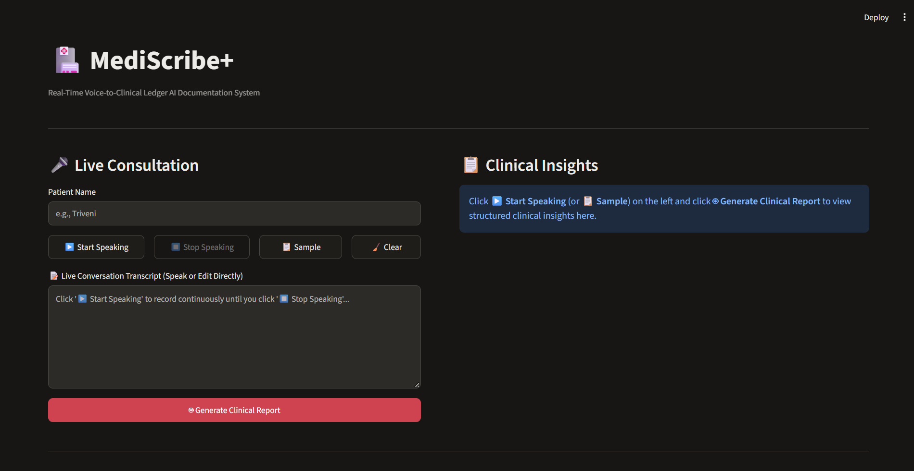
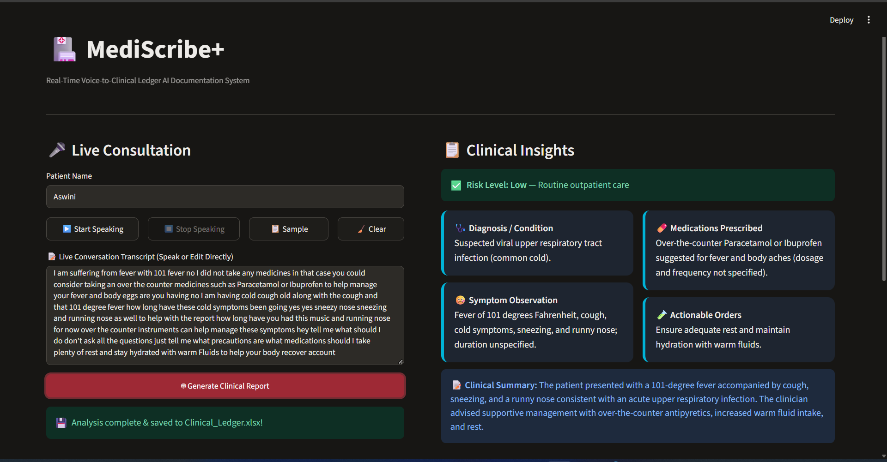
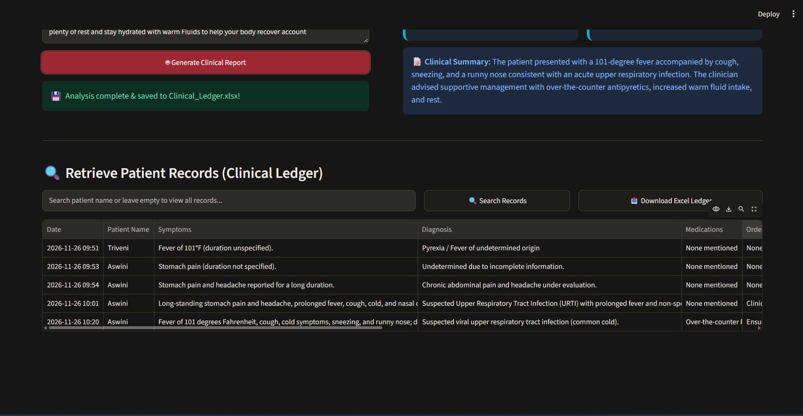

# 🏥 MediScribe+ — Real-Time Voice-to-Clinical Ledger AI System

MediScribe+ is an AI-powered clinical documentation assistant that captures live doctor-patient consultations via continuous microphone streaming, extracts structured clinical insights using Gemini AI, and logs patient records into a searchable Excel Clinical Ledger.

## 📸 Application Preview




## 🚀 Key Features
* **Continuous Live Voice Capture:** Start/Stop background microphone recording captures multi-sentence consultations smoothly across natural pauses.
* **Structured Clinical Extraction:** Uses Google GenAI (`gemini-3.8-flash` with automatic fallback to `gemini-3.8-flash-lite`) and Pydantic schemas to extract Symptoms, Diagnosis, Medications, Actionable Orders, Clinical Summary, and Risk Level (`Low` / `Medium` / `High`).
* **Automated Clinical Ledger (`Clinical_Ledger.xlsx`):** Automatically appends every verified consultation to an Excel ledger with one-click download support.
* **Instant Patient Search:** Filter and retrieve historical patient records directly from the dashboard.

## 🛠️ Tech Stack
* **Frontend:** Streamlit
* **AI & Schema Validation:** Google GenAI SDK (`gemini-3.8-flash`), Pydantic
* **Speech-to-Text:** SpeechRecognition, PyAudio
* **Data Storage:** Pandas, OpenPyXL

## ⚙️ How to Run Locally
1. **Clone the repository:**
   ```bash
   git clone [https://github.com/YOUR_USERNAME/mediscribe-plus.git](https://github.com/YOUR_USERNAME/mediscribe-plus.git)
   cd mediscribe-plus